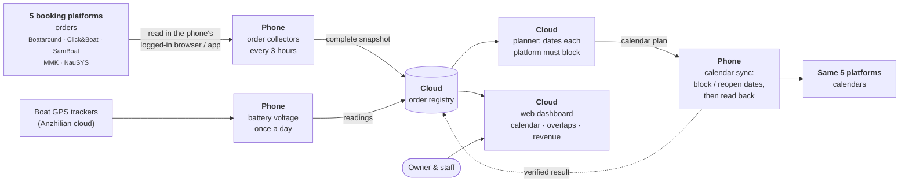

# Fleet Booking Sync Dashboard

My family runs a yacht charter company in Phuket, and our boats are listed on five booking websites. I built this dashboard and a phone-based sync service so that when a boat gets booked on one site, the same dates are blocked on the others, and everyone in the office can see all the bookings in one calendar.


*This screenshot uses demo data. In this copy I changed the company, boat and model names to made-up ones (like "Tidewyn Charters" and "Seacat 40"), and removed or replaced customer details, order numbers, account IDs and real prices. The interface is in Chinese because that's what our team uses.*

## The problem

We have 8 yachts, and they're listed on Boataround, Click&Boat, SamBoat, MMK (Booking Manager) and NauSYS. Each site has its own calendar and its own back office.

Before this, when a boat got booked on one site, somebody had to log in to the other four and block the same dates by hand. Our staff even copied bookings into NauSYS one at a time. If someone forgot one site, the same boat could get sold twice for the same nights, or a paid order could be missed.

On top of that, every platform has its own idea of what a "real" booking is (paid, deposit paid, accepted, option, reservation...), its own date format and its own time zone. Our dashboard uses Beijing time (UTC+8).

## What it does

Everything listed here is in this repository.

- Shows active orders from all five platforms on one calendar: 8 boats, 15 months ahead. Each order links back to the platform it came from.
- Every 3 hours, or when someone presses Sync now, the phone reads the active orders from all five platforms and uploads them.
- When a boat is booked on one platform, the phone blocks those dates on the other platforms, then reads the calendar again to check that it worked. When an order is cancelled, it only reopens dates it blocked itself.
- If a platform fails to load, the system doesn't treat that as the orders being cancelled. While any platform's data is uncertain, it still blocks new dates but won't reopen any. We call this "close-only".
- It never touches blocks that staff made by hand. Every block the program makes is written down in a ledger.
- If two orders overlap on the same boat, both get flagged, with links.
- Staff can add bookings that came in through WhatsApp or phone calls, and dates when a boat isn't available (maintenance, owner use). These get synced to the platforms too.
- A revenue view shows expected income from today on, by platform, boat and month. It uses each platform's own net figure and never adds different currencies together.
- Once a day the phone reads each boat's battery voltage and idle time from its GPS tracker. If the voltage is low, the boat's card turns yellow.
- It shows when each platform last synced, and why if it failed. If a login expires, the phone logs back in with the passwords saved in its browser (no passwords are kept in this code). If a site shows a bot check, the system reports it and stops instead of trying to get around it.
- The interface looks like a paper notebook, and a mouse mascot shows the sync status: syncing, needs attention (with links), or orders updated at a given time.
- 1,580 automated tests (`npm test`).

## How it works




| Part | What it is | Where in the repo |
|---|---|---|
| Dashboard | A Cloudflare Worker with a Durable Object for storage. It serves the web page, keeps the order registry and works out which dates each platform needs to block. It's built from a baseline plus a chain of small patches. | `fleet-order-sync/build.mjs`, `*-patch.cjs`, `worker/`, `reverse-sync/planner.mjs` |
| Phone service | Node.js running in Termux on a spare Android phone. It controls the phone's own Chrome (where the platforms are already logged in) through the DevTools protocol, and reads the official Click&Boat app's screen through Android's accessibility tree (uiautomator). | `fleet-order-sync/phone-server/`, `collectors/`, `reverse-sync/*-adapter.mjs` |
| Phone setup | Services that start at boot, and a watchdog that restarts them. | `phone-server-deployment/provision/` |
| Battery voltage | The phone uses root to reuse the tracker app's existing login, then asks the tracker company's server for the daily readings. Read-only. | `fleet-order-sync/phone-server/voltage.mjs` |

We can't use APIs for orders or calendars on any of these platforms, so the phone does what a person would do. It opens the same pages and app screens, reads them and clicks the same buttons. After every change it reads the calendar again to make sure the change is really there.

## Design decisions & iterations

These are the main problems I ran into, what I decided, and what happened, in order. The dates come from the project's maintenance records.

**1. Moving from a cloud browser to a phone (Sept 2026)**

The first version ran the platform readers in Cloudflare's free cloud browser. The free quota was really tight, and I had to log in to each platform again inside that browser. I decided to use a spare Android phone instead, since it was already logged in to every platform and could stay on all day. It has run the sync around the clock since then, and nobody's computer has to be on.

**2. The login bug (14 Sept 2026)**

Boataround stopped syncing. The program decided the account had been logged out and asked for a new login. That didn't make sense to me, because the phone had the password saved and Boataround was working fine in its Chrome, so I pointed that out. It turned out the service was using a separate browser that had never been logged in. We switched it to the phone's own Chrome, and later every platform got automatic login recovery using the saved passwords.

**3. Not fighting bot protection (28–29 Sept 2026)**

Click&Boat's website started showing a "verify you are human" page to our automated browser, and even clicking through it by hand didn't work. I didn't want to try to trick it, so we switched to the official Click&Boat Android app. Now orders and calendar changes for Click&Boat go through the app's screen, the same way a person would use it. It's slower, about 35 to 55 seconds per boat, but it's stable and stays within the platform's rules.

**4. Never deleting blocks people made by hand (29 Sept 2026)**

An automatic sync could, in theory, delete a block that someone on our staff made on purpose. I made it a rule that the program can only remove blocks it created itself and wrote down in its ledger. Staff blocks stay, even if they look wrong. Now every block has an owner, and a cancelled order only reopens the program's own blocks.

**5. One broken platform shouldn't stop everything (29 Sept 2026)**

When one platform failed to load, all calendar syncing paused. One time it stayed paused for about 6 hours. I decided the system should keep blocking dates for new bookings, but never reopen anything while any source is uncertain. After that, the other platforms kept syncing, and nothing could get reopened by mistake.

**6. Battery voltage on the dashboard (Sept–Oct 2026)**

Our boats can sit unused for days, and a flat battery is a bad start to the next charter. The GPS trackers' app shows the voltage, but nobody was checking it every day. So I had the phone read it once a day and show it on each boat's card. It only reads, and we don't store another password for it. On 10 Oct I noticed that one tracker had readings in its app but nothing on our dashboard. It turned out the tracker was assigned to the wrong boat, and we fixed the mapping.

**7. An order in my email that wasn't on the dashboard (12 Oct 2026)**

I got a NauSYS email about a new booking, but it wasn't on the dashboard, so I asked why. We checked how NauSYS itself lists it. It was a "waiting option", queued behind another agency's option, and NauSYS lists those as enquiries, not bookings. So the dashboard was right. When it turned into a real option, the system picked it up and blocked the dates.

**8. A cancellation the system missed (12 Oct 2026)**

One boat showed a "please verify reopening" warning, and its dates were still blocked on four platforms, even though the agency's option had already expired. I sent a screenshot and asked what was going on. It turned out that when NauSYS auto-cancels an expired option, it changes the "created by" column, so the system didn't recognize the cancellation. The rule was fixed and the dates were reopened the same day.

**9. A friendlier interface (13 Oct 2026)**

I wanted the dashboard to feel friendlier, and I wanted people to see the sync status right away instead of reading a long line of text. I picked a notebook-style redesign with a mascot that only reports what's actually happening. It doesn't celebrate or say everything is fine. The status now sits next to the Sync now button, and anything that needs attention links straight to the problem.

## My role and use of AI

I started this project in May 2026 and I still run it. I decide what it needs to do, set the rules, design how it looks, test it on our real platforms and keep it running for the business. The owner and almost all of our staff use it.

Here's what I did:

- I decided what the system should do and set its business rules, like what counts as a real booking on each platform, "close-only" when a source is uncertain, never touching blocks made by staff, and how revenue is counted and shown.
- I made the big decisions: moving from a cloud browser to a phone, using the official Click&Boat app instead of fighting bot protection, adding MMK and NauSYS as order sources, and adding battery voltage.
- I laid out the dashboard (for example, revenue shows the total first and the details when you click) and chose the notebook-and-mascot redesign.
- I approved and checked live tests on our real platform calendars, compared the results with the platforms and reported problems with screenshots. Several of the changes above started with something I noticed.
- I set up and look after the phone, and keep the system running.
- On 10 Oct 2026 I had every platform's back office compared order by order with the dashboard. All 40 active orders matched.

How I used AI: the code (the dashboard, phone service, platform readers, calendar sync, the 1,580 tests and the deployment scripts) was written by AI coding assistants, first OpenAI Codex and then Anthropic Claude Code from late September 2026, based on my requirements. I did not write most of the code by hand. This README and the portfolio descriptions were also drafted with Claude Code, from my decisions and the project records.

## What I learned / Next steps

What I learned:

- A change being saved isn't the same as it actually showing up on the platform. So the system only counts something as done after it reads the calendar back.
- When a page doesn't load, that tells you nothing about the order. The system keeps the last complete data and says it couldn't update.
- The AI assistants follow my rules very literally, so a vague rule gives wrong results. A lot of my work turned out to be writing the rules exactly.
- Using the official app was slower than getting around the bot check, but I'd rather do it the way the platform allows.

Next steps:

- Use official platform APIs if they become available, instead of reading pages.
- Connect the boats and platforms that aren't linked yet. One boat is only on NauSYS, and a few SamBoat listings aren't linked.
- Read the battery data over HTTPS. When I built this, the tracker company's server only worked over plain HTTP.
- Add an English version of the interface.

## Setup (demo data, no real accounts)

You need [Node.js](https://nodejs.org/) 22 or later (I developed it on 24.19).

```bash
git clone https://github.com/maiyuge630/fleet-booking-sync-dashboard.git
cd fleet-booking-sync-dashboard/fleet-order-sync
npm ci --ignore-scripts --no-audit --no-fund
npm run build
npm run demo
```

Then open <http://localhost:8891/?scenario=normal>. Other demo states are `syncing`, `attention`, `offline`, `loading` and `error` (for example `?scenario=attention`). The demo server uses made-up orders and never contacts a booking platform.

To run the tests (after `npm run build`):

```bash
npm test
```

The phone service itself needs a rooted Android phone with Termux and logged-in platform accounts, so it can't run from this repository alone. `.env.example` lists the settings a real deployment keeps outside the repository. The demo doesn't need any of them. The phone's watchdog test (`phone-server-deployment/provision/fleet-runtime-watchdog.test.mjs`) needs GNU Bash, so it runs on the phone.

## Repository layout

```
fleet-order-sync/            dashboard build, patches, phone service, platform readers, tests
  build.mjs                  builds the Cloudflare Worker (after/cloudflare.js)
  phone-server/              the service running on the phone
  collectors/                read orders from each platform
  reverse-sync/              calendar sync: planner, executor, one adapter per platform
  worker/                    order registry inside the Worker
  demo/preview-server.cjs    local demo with made-up data
  evidence/ …                anonymized page samples used by the tests
cloudflare-boataround-orders/, cloudflare-migration/   the original dashboard the patches build on
phone-server-deployment/provision/                     phone install scripts and watchdog
docs/                        architecture diagram and screenshots
```

## Credits

The mouse mascot images come from the [fantasy-mouse-ui](https://github.com/LaoFeng-mouse/fantasy-mouse-ui) project.
