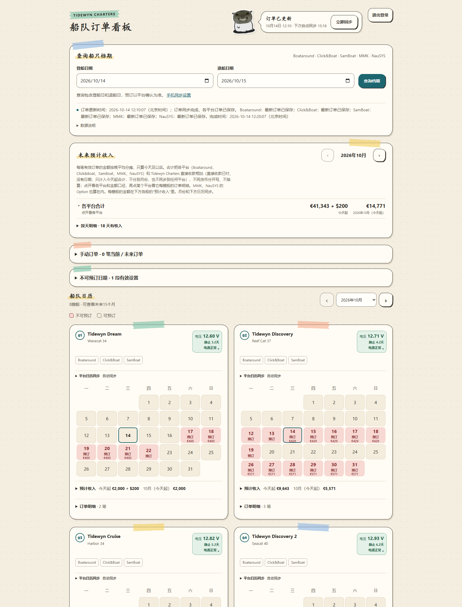
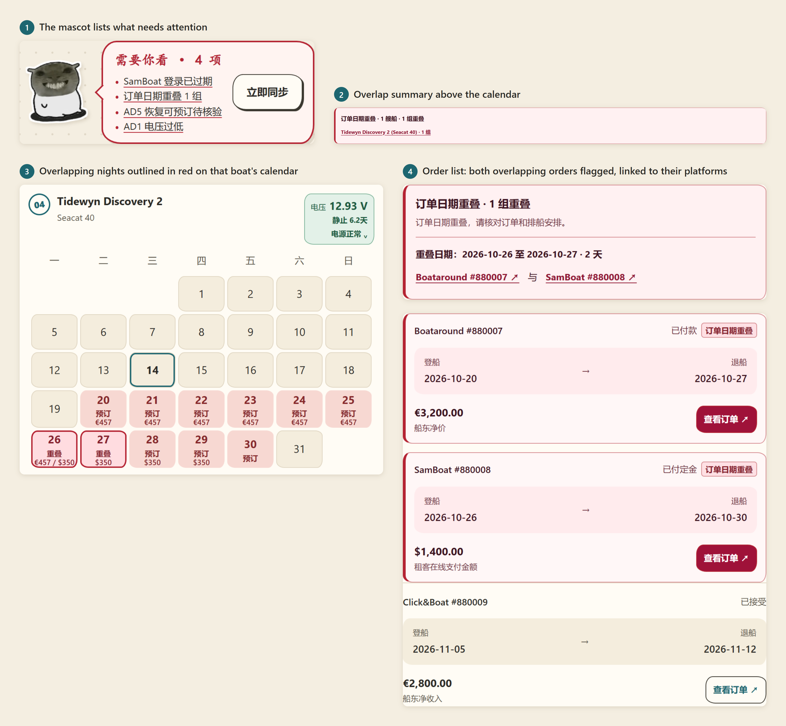
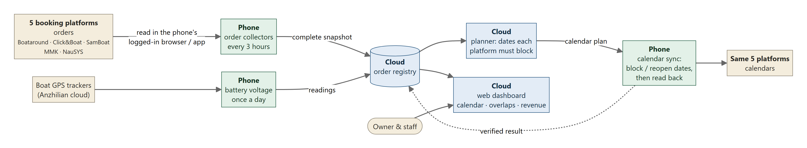
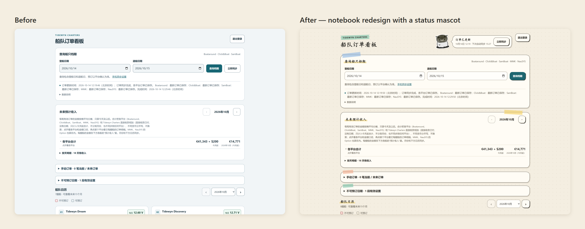
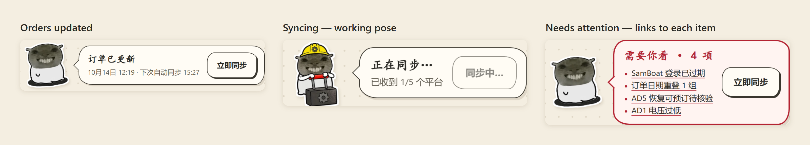

# Portfolio pieces

Five pieces from my Fleet Booking Sync Dashboard. All the screenshots use made-up demo data, and the company, boat and model names are fictional. I drafted these descriptions with Claude Code, from my decisions and the project records.

## 1. The Dashboard

Our staff used to block dates by hand on five booking sites so none of our eight boats got sold twice. I designed this dashboard to put all the orders in one place. I decided which platforms it covers, what counts as a real booking on each one, and how the page is laid out: the fleet calendar, revenue (totals first, details when you click) and each boat's battery voltage. The owner and almost all our staff use it now.

Tools: HTML, CSS and JavaScript on Cloudflare Workers, Node.js, and headless Chrome for the screenshot.

AI use: The code was written by AI coding assistants (OpenAI Codex, Anthropic Claude Code) based on my requirements.

## 2. Double Booking Warnings

A boat listed on five platforms can get sold twice for the same nights. I wanted that to be hard to miss, so the warning shows up in four places: the mascot's list, a summary above the calendar, red outlines on the nights, and a flag on both orders with links to their platforms. I also decided a turnover day doesn't count as a conflict. One guest leaving in the morning and the next arriving in the afternoon is normal.

Tools: HTML, CSS and JavaScript, plus puppeteer and headless Chrome for the close-ups.

AI use: The code was written by AI coding assistants based on my rules.

## 3. How the System Works

We can't use APIs for orders or calendars on any booking platform, so I had to plan around that. I first tried Cloudflare's free cloud browser, but the quota was really tight and I had to log in to each platform again in there. So I moved the work to a spare Android phone that stays logged in. The phone reads the orders, the cloud works out which dates to block, then the phone blocks them and checks.

Tools: Mermaid (a diagram written as code), and headless Chrome to export the image.

AI use: The diagram code was generated with Claude Code.

## 4. Before and After the Redesign

Same demo data, before and after my redesign. I went with a paper notebook look, with tape labels, handwritten-style headings and a dotted page, plus a mascot next to the Sync button so you can see the sync status right away. I only changed how it looks. The colors mean the same things as before, and none of the data rules changed. The redesign also fixed a heading that still said "7 boats" after we added our eighth.

Tools: CSS and JavaScript, and mascot images from the fantasy-mouse-ui project.

AI use: Claude Code wrote the code in the direction I chose. The mascot artwork is from fantasy-mouse-ui. I didn't draw it, and neither did AI.

## 5. The Mascot's Three States

I didn't want a mascot that's just decoration, so I gave it a job. It has three states, all based on real data: "orders updated" with the time, a working pose only while the phone is really syncing, and a red "needs your attention" list where each item links to the problem. It never celebrates or says everything is fine, because I don't want anyone to miss a real problem.

Tools: CSS and JavaScript, and mascot images from the fantasy-mouse-ui project.

AI use: Claude Code wrote the code based on my rules. The mascot artwork is from fantasy-mouse-ui. I didn't draw it, and neither did AI.
